# Secure & Scalable AWS Infrastructure

A hands-on AWS project in the Asia Pacific (Mumbai) region (`ap-south-1`): a custom VPC with public and private subnets, a hardened public Ubuntu web server running Nginx, Linux access control with ACLs, EBS encryption settings and CloudWatch monitoring. A separately labelled design shows how the environment would grow into a load-balanced, auto-scaled, multi-AZ production system.

> **Reading this repository honestly.** The *implemented* environment is small: one VPC and one EC2 web server. Load balancing, Auto Scaling, a database tier, and backup/DR are *proposed designs*, not deployed. Every claim is tagged **Verified** (visible in a screenshot), **Author-stated** (reported but not captured), **Inspected**, or **Conceptual**. Gaps are listed in the [missing-evidence checklist](documentation/missing-evidence-checklist.md).

## Contents

1. [Purpose](#1-purpose)
2. [Technical objectives](#2-technical-objectives)
3. [Technology stack](#3-technology-stack)
4. [Implemented architecture](#4-implemented-architecture)
5. [Proposed production architecture](#5-proposed-production-architecture)
6. [Actual AWS infrastructure](#6-actual-aws-infrastructure)
7. [VPC and subnet design](#7-vpc-and-subnet-design)
8. [Internet Gateway and routing](#8-internet-gateway-and-routing)
9. [EC2 and Nginx deployment](#9-ec2-and-nginx-deployment)
10. [Linux administration](#10-linux-administration)
11. [Security implementation](#11-security-implementation)
12. [EBS and encryption](#12-ebs-and-encryption)
13. [CloudWatch monitoring](#13-cloudwatch-monitoring)
14. [Backup and disaster recovery](#14-backup-and-disaster-recovery)
15. [Load balancing and Auto Scaling](#15-load-balancing-and-auto-scaling)
16. [Troubleshooting methodology](#16-troubleshooting-methodology)
17. [Screenshot gallery](#17-screenshot-gallery)
18. [Security considerations](#18-security-considerations)
19. [Cost considerations](#19-cost-considerations)
20. [Challenges and lessons learned](#20-challenges-and-lessons-learned)
21. [Future improvements](#21-future-improvements)
22. [Limitations](#22-limitations)
23. [Learning outcomes](#23-learning-outcomes)
24. [Repository structure and documentation index](#24-repository-structure-and-documentation-index)

## 1. Purpose

To design, build and document a secure network foundation on AWS, deploy a real workload into it, and show the reasoning behind each control, including where the current implementation falls short of production standards.

## 2. Technical objectives

- Design a non-overlapping IPv4 address plan with public and private tiers across two Availability Zones.
- Provide controlled internet access with an Internet Gateway and explicit route tables.
- Deploy and expose an Ubuntu/Nginx server with a least-exposure security group (no SSH open to the world).
- Apply OS-level access control with users, groups, setgid directories and POSIX ACLs.
- Inspect EBS encryption defaults and CloudWatch metrics, and record what they do and do not show.
- Document a credible path to high availability and resilience without claiming it is built.

## 3. Technology stack

| Area | Technology |
|---|---|
| Cloud | Amazon Web Services, `ap-south-1` |
| Networking | VPC, subnets, Internet Gateway, route tables, security groups |
| Compute | EC2 `t3.micro` |
| Operating system | Ubuntu Server 24.04 |
| Web server | Nginx |
| Storage / encryption | EBS gp3, AWS KMS (account default encryption) |
| Monitoring | Amazon CloudWatch (basic EC2 monitoring) |
| Access control | Linux users, groups, ACLs; IAM (conceptual) |
| Documentation | Markdown, Mermaid |

## 4. Implemented architecture

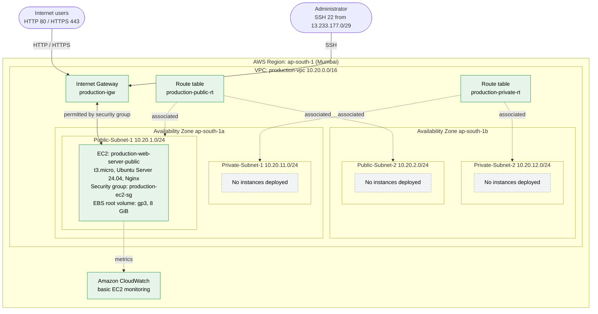

Green boxes are deployed; grey dashed boxes are deployed subnets with no workloads. Details and caveats: [architecture/README.md](architecture/README.md).

## 5. Proposed production architecture

> **Design only. None of the orange components are deployed.**

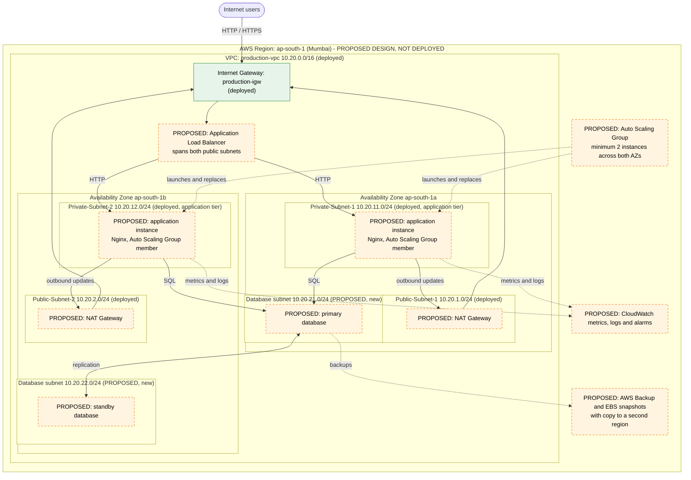

Reasoning: [11 - Load balancing and Auto Scaling](documentation/11-load-balancing-and-auto-scaling.md), [10 - Backup and DR](documentation/10-backup-and-disaster-recovery.md).

## 6. Actual AWS infrastructure

| Component | Value | Status |
|---|---|---|
| Region | Asia Pacific (Mumbai), `ap-south-1` | Verified |
| VPC | `production-vpc`, 10.20.0.0/16 | Verified |
| Subnets | 4 (2 public, 2 private) | Verified |
| Internet Gateway | `production-igw`, attached | Verified |
| Route tables | `production-public-rt`, `production-private-rt` (2 subnets each) | Verified; routes not captured |
| EC2 | `production-web-server-public`, `t3.micro`, ap-south-1a, 3/3 checks passed | Verified |
| OS | Ubuntu Server 24.04 | Author-stated (consistent with apt output) |
| Web server | Nginx (default page shown) | Verified |
| Security group | `production-ec2-sg`: 80 and 443 open, 22 from 13.233.177.0/29 | Verified |
| Root volume | gp3, 8 GiB, 3000 IOPS, 125 MiB/s | Verified |
| EBS default encryption | Enabled for new volumes in the Region | Verified |
| Root volume encrypted | No | Author-stated; not visible |
| Monitoring | Basic CloudWatch; no alarms | Verified |

## 7. VPC and subnet design

| Subnet | CIDR | Availability Zone | Tier | Status |
|---|---|---|---|---|
| Public-Subnet-1 | 10.20.1.0/24 | ap-south-1a | Public (hosts the web server) | CIDR verified; AZ author-stated |
| Public-Subnet-2 | 10.20.2.0/24 | ap-south-1b | Public (empty) | Verified |
| Private-Subnet-1 | 10.20.11.0/24 | ap-south-1a | Private (empty) | CIDR verified; AZ author-stated |
| Private-Subnet-2 | 10.20.12.0/24 | ap-south-1b | Private (empty) | CIDR verified; AZ author-stated |

The /16 VPC leaves room for further tiers, such as database subnets at 10.20.21.0/24 and 10.20.22.0/24. A /24 gives 251 usable addresses because AWS reserves five. More: [02](documentation/02-vpc-and-networking.md), [03](documentation/03-public-and-private-subnets.md).

## 8. Internet Gateway and routing

A subnet is public only if its route table sends `0.0.0.0/0` to an Internet Gateway. `production-public-rt` is associated with the two public subnets and is intended to hold `local` plus `0.0.0.0/0 -> production-igw`. `production-private-rt` is associated with the two private subnets and is intended to hold only the `local` route, so those subnets have no internet path. No NAT gateway exists, so private instances would currently have no outbound internet access.

The Routes tabs were not captured, so the default route itself is not independently evidenced.

## 9. EC2 and Nginx deployment

One `t3.micro` instance runs in Public-Subnet-1 with private IP 10.20.1.254 and an auto-assigned public IPv4 (not an Elastic IP, so it changes on stop/start). Nginx serves its default welcome page. TLS is not evidenced. Details: [04](documentation/04-ec2-and-nginx-deployment.md).

## 10. Linux administration

| Item | Observed |
|---|---|
| Users | `ubuntu` (1000), `devops` (1001), `tester` (1003) |
| Group | `cloudteam` (1002): `devops`, `ubuntu` |
| Directory | `/opt/cloud-project`, `root:cloudteam`, `drwxrws---+` (setgid) |
| ACL | `user:tester:r-x`, `group::rwx`, `mask::rwx`, `other::---` |

`tester` is outside the group and receives read-and-traverse only via the ACL. Details: [05](documentation/05-linux-administration.md), [users and groups](linux/users-and-groups.md), [permissions and ACLs](linux/permissions-and-acls.md), [service management](linux/service-management.md).

## 11. Security implementation

| Layer | Control |
|---|---|
| Network | Custom VPC, public/private split |
| Instance firewall | Security group: HTTP/HTTPS public, SSH only from a /29 range; **never 0.0.0.0/0 for SSH** |
| Host | Named users, shared group, setgid directory, ACL |
| Data | Account-level EBS default encryption; AMI public sharing blocked |
| Visibility | Basic CloudWatch metrics (no alarms, Flow Logs or CloudTrail evidence) |

Findings and recommendations (TLS on 443, patching, root volume encryption, alarms, IMDSv2): [07](documentation/07-security-architecture.md). IAM is conceptual only: [06](documentation/06-iam-and-access-management.md).

## 12. EBS and encryption

The root volume is gp3, 8 GiB, 3000 IOPS, 125 MiB/s, attached at `/dev/sda1`. "Always encrypt new EBS volumes" is enabled for the Region, which affects only **newly created** volumes; the existing root volume is reported unencrypted, and an illustrative migration path is documented but was not performed. Details: [08](documentation/08-ebs-and-storage.md).

## 13. CloudWatch monitoring

In a 1-hour view, CPU stayed below 1% (axis maximum 0.78%), with network activity peaking early in the window and then idling. A 3.62% CPU reading mentioned by the author is not visible in the screenshots. No alarms are configured. Details and recommended alarms: [09](documentation/09-cloudwatch-monitoring.md).

## 14. Backup and disaster recovery

Conceptual. The proposed strategy covers encrypted golden AMIs, scheduled EBS snapshots with retention, cross-Region copies, tested restores, and Multi-AZ for a future database, with RPO/RTO targets stated as illustrative. Nothing is implemented. See [10](documentation/10-backup-and-disaster-recovery.md).

## 15. Load balancing and Auto Scaling

Conceptual. An ALB in the public subnets would front an Auto Scaling group in the private subnets of both Availability Zones, with security-group-to-security-group rules between tiers and SSM Session Manager replacing SSH. See [11](documentation/11-load-balancing-and-auto-scaling.md).

## 16. Troubleshooting methodology

Work outside-in: instance state and status checks, public address, route to the Internet Gateway, security group, network ACL, service state and listening port, local `curl`, then logs. The full table and the issues observed during the build are in [12](documentation/12-troubleshooting-and-lessons-learned.md).

## 17. Screenshot gallery

All screenshots are real, sanitised captures (account IDs, public IP and a personal name redacted). Click to enlarge. Index and sanitisation notes: [screenshots/README.md](screenshots/README.md).

| | |
|---|---|
| [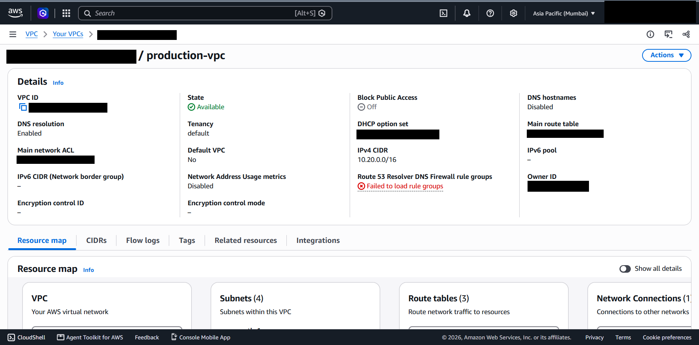](screenshots/networking/vpc-configuration.png)<br>*VPC `production-vpc`* | [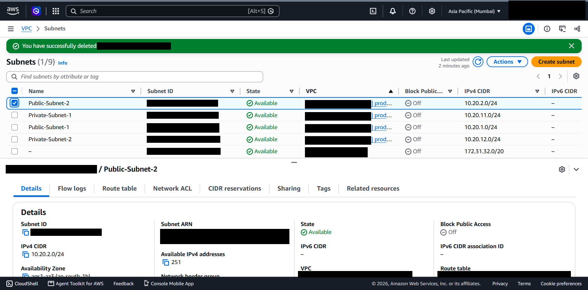](screenshots/networking/subnet-configuration.png)<br>*Subnets and CIDRs* |
| [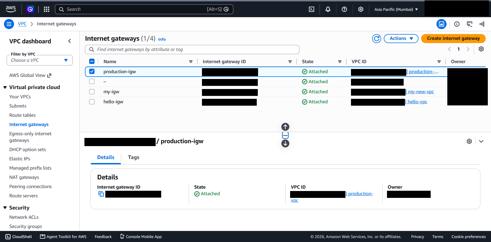](screenshots/networking/internet-gateway.png)<br>*`production-igw` attached* | [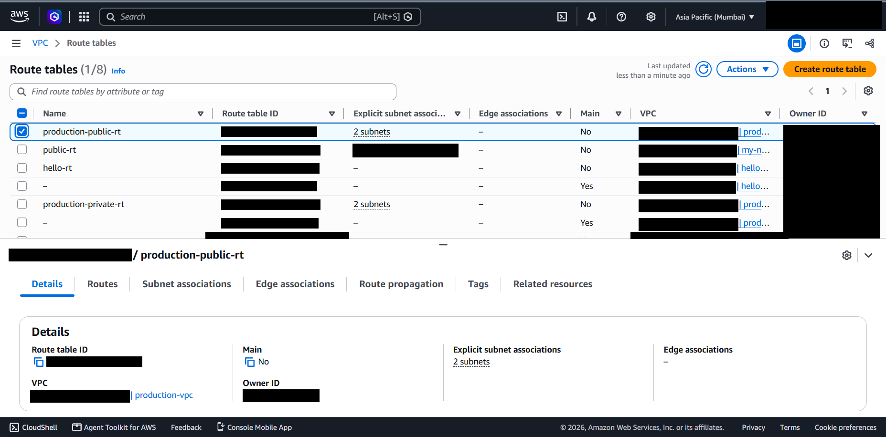](screenshots/networking/public-route-table.png)<br>*Public and private route tables* |
| [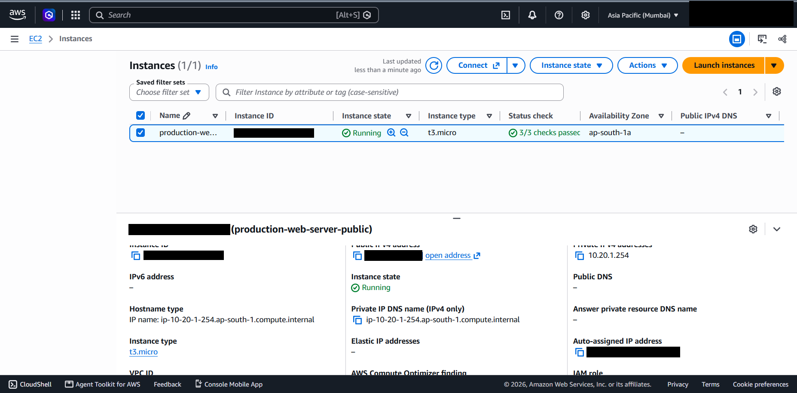](screenshots/ec2-linux/ec2-instance-details.png)<br>*EC2 instance details* | [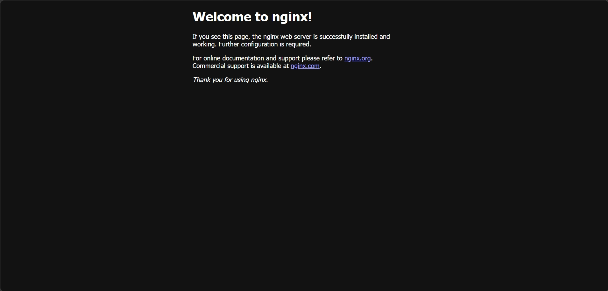](screenshots/ec2-linux/nginx-default-page.png)<br>*Nginx default page* |
| [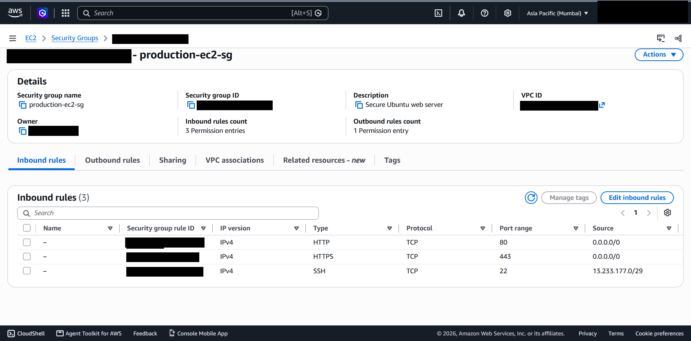](screenshots/security/security-group-rules.png)<br>*Security group inbound rules* | [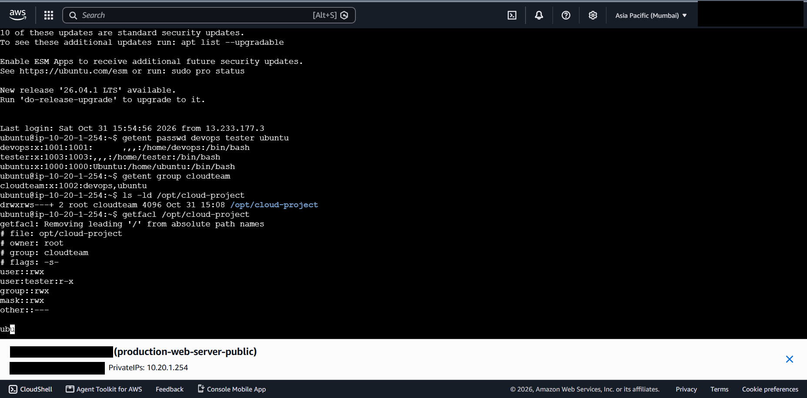](screenshots/ec2-linux/linux-users-groups-acl.png)<br>*Users, group, directory mode, ACL* |
| [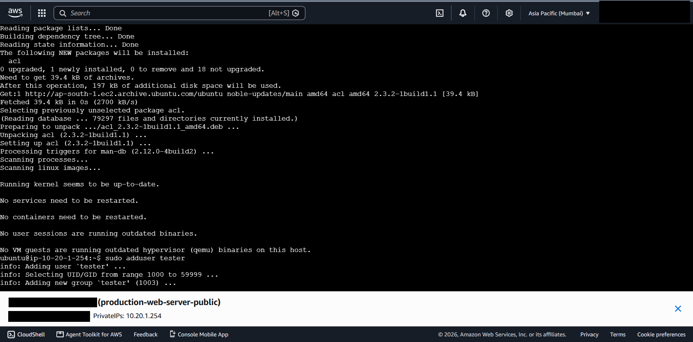](screenshots/ec2-linux/linux-acl-install-and-user-creation.png)<br>*`acl` package and `adduser tester`* | [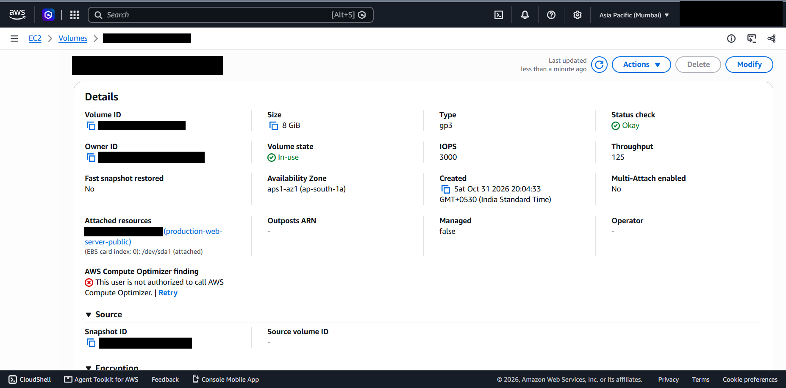](screenshots/storage/ebs-volume-details.png)<br>*EBS root volume* |
| [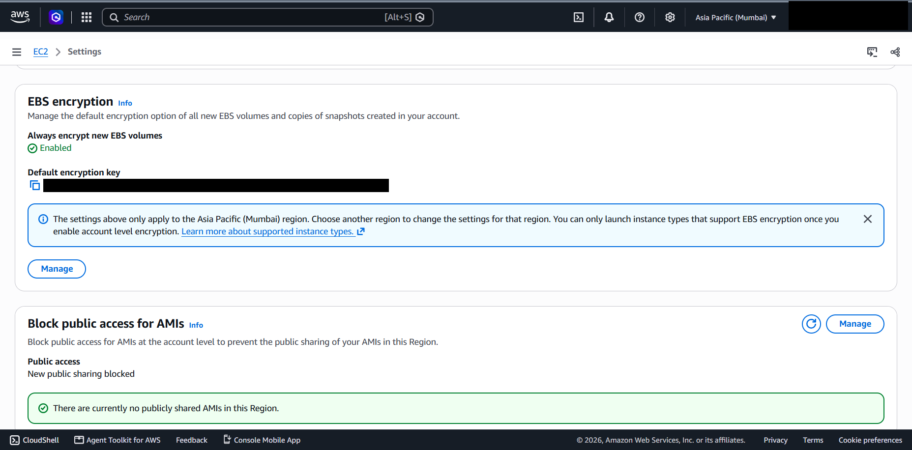](screenshots/storage/ebs-encryption-settings.png)<br>*EBS default encryption* | [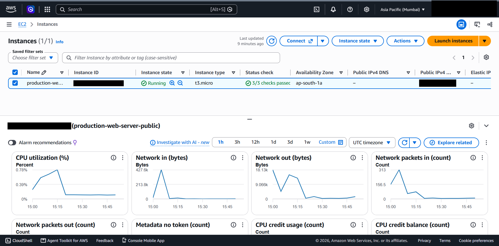](screenshots/monitoring/cloudwatch-monitoring.png)<br>*EC2 monitoring charts* |

## 18. Security considerations

- SSH is restricted to 13.233.177.0/29 and is never recommended open to `0.0.0.0/0`.
- Port 443 is open but TLS was not evidenced; either configure it or close the port.
- Pending OS security updates should be applied.
- The public IP is dynamic and deliberately omitted from this repository.
- No access keys, passwords, private keys or account IDs are published; the `.gitignore` blocks common secret files.
- All AWS resource identifiers (VPC, subnet, route table, internet gateway, instance, volume, snapshot, security group, KMS key) and the account ID are redacted in the screenshots; resource names stay visible. New screenshots must be redacted before they are committed.

## 19. Cost considerations

Core networking (VPC, subnets, Internet Gateway, route tables, security groups) is free. Costs come from the instance, EBS storage, public IPv4 addresses, data transfer, and, in the proposed design, NAT gateways, an ALB, additional instances, a database and backups. NAT gateways and idle load balancers are the usual surprises. Stop or delete lab resources when finished, and check current AWS pricing before deploying the proposed design.

## 20. Challenges and lessons learned

- Evidence quality matters as much as the build; several claims remain author-stated because the proving page was not captured.
- Account-level encryption defaults protect only new volumes.
- An open port is not a working service (443 without TLS).
- Console screenshots leak identifiers; sanitise before publishing.
- Private subnets need an egress plan (NAT or endpoints) before workloads are placed there.

Full list: [12](documentation/12-troubleshooting-and-lessons-learned.md).

## 21. Future improvements

1. Capture the missing evidence ([checklist](documentation/missing-evidence-checklist.md)).
2. Define the environment in Terraform or CloudFormation.
3. Configure TLS, harden Nginx, enable unattended security upgrades.
4. Migrate the root volume to an encrypted volume or AMI.
5. Add CloudWatch alarms, the CloudWatch agent, VPC Flow Logs and CloudTrail.
6. Replace SSH with SSM Session Manager and attach a least-privilege instance role.
7. Build the ALB, Auto Scaling group and private database tier, then add real evidence.
8. Automate snapshots and test a restore.

## 22. Limitations

- Single instance in a single Availability Zone: not highly available.
- Root volume reported unencrypted; no TLS evidenced; no alarms; no backups.
- No NAT gateway, so private subnets have no outbound internet access.
- Several details are author-stated rather than screenshot-verified (see the checklist).
- IAM, backup/DR, load balancing and Auto Scaling are conceptual.
- Costs are described qualitatively; no price figures are asserted.

## 23. Learning outcomes

- Designing and justifying a VPC address plan and public/private tiering.
- Understanding that route tables, not names, make a subnet public.
- Writing least-exposure security group rules.
- Using setgid directories and POSIX ACLs for shared and restricted access.
- Distinguishing account-level defaults from per-resource state (EBS encryption).
- Reading CloudWatch metrics for burstable instances.
- Separating implemented work from proposed design in technical documentation.

## 24. Repository structure and documentation index

```text
secure-scalable-aws-infrastructure/
|-- README.md
|-- LICENSE              CC BY 4.0
|-- .gitignore
|-- architecture/        implemented and proposed diagrams (.mmd) and notes
|-- documentation/       01 to 12 topic documents and the missing-evidence checklist
|-- linux/               users and groups, permissions and ACLs, service management
`-- screenshots/         sanitised evidence by topic
```

| Document | Topic |
|---|---|
| [01](documentation/01-project-overview.md) | Overview and evidence classification |
| [02](documentation/02-vpc-and-networking.md) | VPC, Internet Gateway, route tables |
| [03](documentation/03-public-and-private-subnets.md) | Subnet design |
| [04](documentation/04-ec2-and-nginx-deployment.md) | EC2 and Nginx |
| [05](documentation/05-linux-administration.md) | Linux users, groups, ACLs |
| [06](documentation/06-iam-and-access-management.md) | IAM (conceptual) |
| [07](documentation/07-security-architecture.md) | Security architecture and findings |
| [08](documentation/08-ebs-and-storage.md) | EBS and encryption |
| [09](documentation/09-cloudwatch-monitoring.md) | CloudWatch |
| [10](documentation/10-backup-and-disaster-recovery.md) | Backup and DR (conceptual) |
| [11](documentation/11-load-balancing-and-auto-scaling.md) | ALB and Auto Scaling (conceptual) |
| [12](documentation/12-troubleshooting-and-lessons-learned.md) | Troubleshooting and lessons |
| [Checklist](documentation/missing-evidence-checklist.md) | Missing evidence |

## License

Copyright (c) 2026 Nandhazz28. This work is licensed under the [Creative Commons Attribution 4.0 International License](https://creativecommons.org/licenses/by/4.0/) (CC BY 4.0). The full legal code is in [LICENSE](LICENSE).

The license covers the original text, diagrams and sanitised screenshots in this repository. AWS, Amazon EC2, Amazon VPC and related names and console interface elements remain the property of Amazon Web Services, Inc. or its affiliates; Nginx and Ubuntu are trademarks of their respective owners.
