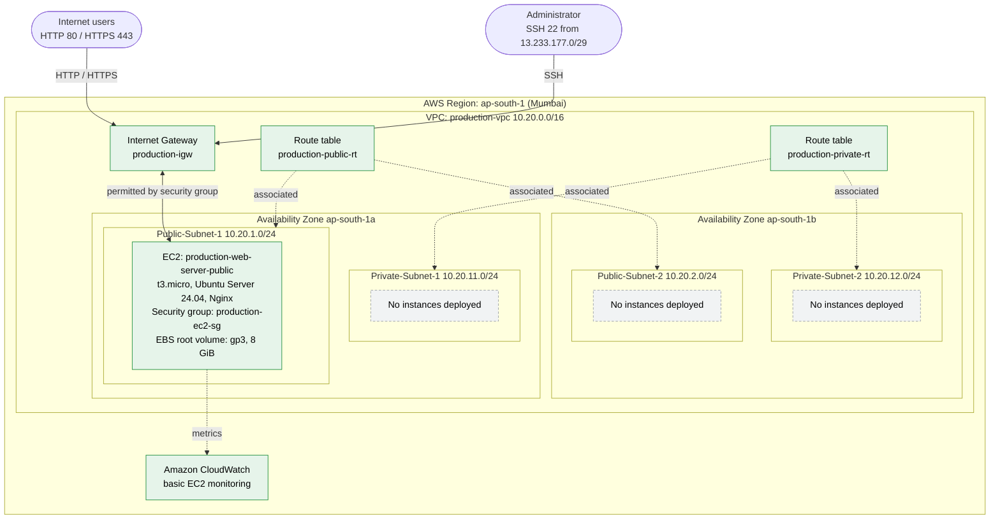
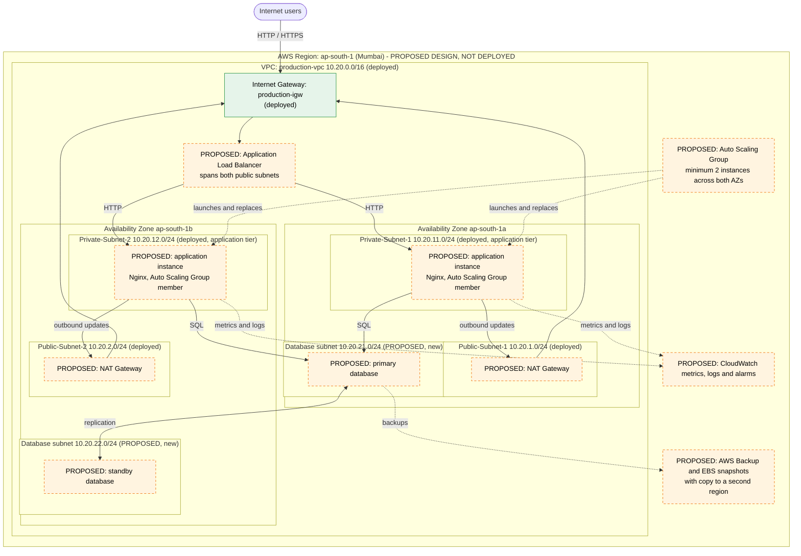

# Architecture

Two separate designs are documented here. Only the first is deployed.

| | Implemented architecture | Proposed production architecture |
|---|---|---|
| Source file | [`implemented-architecture.mmd`](implemented-architecture.mmd) | [`proposed-production-architecture.mmd`](proposed-production-architecture.mmd) |
| Status | Deployed and (mostly) verified by screenshots | Conceptual design only |
| Colour in diagram | Green solid outline = deployed; grey dashed = deployed but empty | Orange dashed = proposed; green = already deployed |

Both files are valid Mermaid flowcharts and render directly on GitHub. The diagrams below are the same content as the `.mmd` files; edit the `.mmd` file and update the copy here when changing either.

## Implemented architecture

### What the diagram shows

- A single VPC (`production-vpc`, 10.20.0.0/16) across two Availability Zones, with two public and two private subnets.
- One Internet Gateway; one public and one private route table, each associated with two subnets.
- One EC2 instance in Public-Subnet-1 protected by a security group, running Nginx, with a gp3 root volume.
- Basic CloudWatch monitoring.
- Traffic: internet users reach the instance on 80/443 and the administrator on 22 (restricted source range), always through the Internet Gateway. Dotted lines are route-table associations and metrics, not traffic.
- Three subnets contain no workloads.

### Evidence caveats

The Availability Zones of Public-Subnet-1 and both private subnets, the subnet-to-route-table mapping, and the routes themselves are author-stated or inferred, not visible in screenshots. See the [missing-evidence checklist](../documentation/missing-evidence-checklist.md).

## Proposed production architecture

### What the diagram proposes

- An Application Load Balancer in the public subnets as the only internet-facing entry point.
- An Auto Scaling group of application instances across the two private subnets.
- A new pair of private database subnets (10.20.21.0/24 and 10.20.22.0/24, not yet created) with a primary and standby database in different Availability Zones.
- NAT gateways for outbound updates, CloudWatch for metrics and logs, and AWS Backup with a copy in a second Region.

**None of the orange components exist.** See [11](../documentation/11-load-balancing-and-auto-scaling.md) and [10](../documentation/10-backup-and-disaster-recovery.md) for the reasoning.

## Component status table

| Component | Status |
|---|---|
| VPC, four subnets, Internet Gateway, two route tables | Deployed |
| EC2 instance, Nginx, security group, EBS root volume | Deployed |
| CloudWatch basic monitoring | Deployed (default behaviour) |
| Linux users, group, setgid directory, ACL | Deployed |
| Application Load Balancer, target group | Proposed |
| Auto Scaling group, launch template | Proposed |
| Application instances in private subnets | Proposed |
| NAT gateways | Proposed |
| Database subnets and database tier | Proposed |
| Alarms, centralised logging | Proposed |
| AWS Backup, snapshots, cross-Region copy | Proposed |
