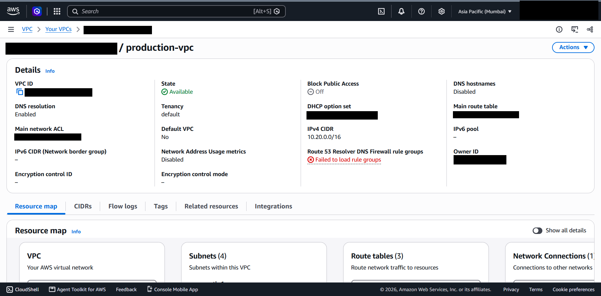
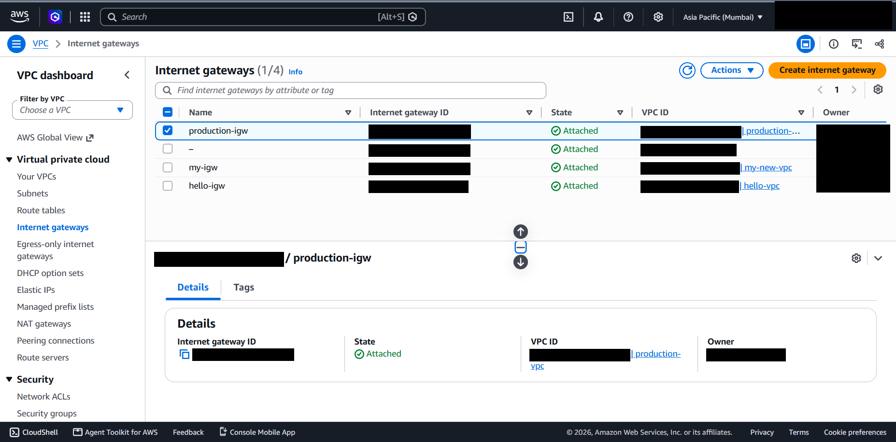
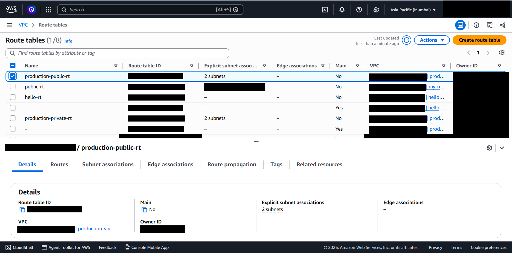

# 02 - VPC and Networking

## What it is

An Amazon VPC is a logically isolated virtual network inside an AWS Region. You choose its IP range, divide it into subnets, and control traffic using route tables, gateways, security groups and network ACLs.

## Why it is needed

A default VPC is convenient but shared in design with every other default VPC. A custom VPC gives explicit control over address space, which subnets are internet-facing, and how tiers are separated. That control is the foundation for every other security decision in this project.

## How it works

- The VPC owns a primary IPv4 CIDR block. Each subnet takes a smaller slice of it and lives in exactly one Availability Zone.
- A subnet is "public" only because its route table sends `0.0.0.0/0` to an Internet Gateway. Nothing else makes it public.
- The Internet Gateway is horizontally scaled and managed by AWS. For an instance to be reachable from the internet it also needs a public IPv4 address and a security group that allows the traffic.
- Route tables use longest-prefix match. The implicit `local` route lets all subnets in the VPC reach each other.

## Configuration in this project

*Figure 2.1 - `production-vpc` details and resource map summary (4 subnets, 3 route tables).*

| Property | Value | Status |
|---|---|---|
| Name | `production-vpc` | Verified |
| IPv4 CIDR | 10.20.0.0/16 (65,536 addresses) | Verified |
| State / tenancy | Available / default | Verified |
| Default VPC | No | Verified |
| DNS resolution | Enabled | Verified |
| DNS hostnames | Disabled | Verified |
| Block Public Access | Off | Verified |
| Subnets / route tables | 4 / 3 | Verified |

*Figure 2.2 - `production-igw` in state Attached to `production-vpc`. The other gateways in the list belong to other VPCs in the same account.*

*Figure 2.3 - `production-public-rt` (2 explicit subnet associations, not the main table) and `production-private-rt` (2 explicit subnet associations).*

### Routing

| Route table | Associated subnets | Intended routes | Status |
|---|---|---|---|
| `production-public-rt` | 2 (the public subnets) | `10.20.0.0/16 -> local`, `0.0.0.0/0 -> production-igw` | Association verified; routes not captured |
| `production-private-rt` | 2 (the private subnets) | `10.20.0.0/16 -> local` only | Association verified; routes not captured |
| Main route table | None explicit | `local` only | Verified to exist |

The Routes tab of both custom route tables was not captured. The default route to the Internet Gateway is therefore **not independently evidenced**, although the working Nginx page strongly implies it. See the [checklist](missing-evidence-checklist.md).

### Observations

- DNS hostnames are disabled, so the EC2 instance has no public DNS name, only a public IPv4 address (visible in the instance details screenshot).
- The VPC page shows "Failed to load rule groups" for Route 53 Resolver DNS Firewall. The cause was not investigated; it is most likely a permissions limitation of the console identity, but that is unconfirmed.

## Security implications

- The /16 leaves ample space for further tiers without re-addressing.
- Private subnets are protected by the absence of an internet route, not by a firewall alone.
- Security groups and NACLs are separate layers. Only the security group was inspected (see [07](07-security-architecture.md)). The default NACL was not inspected.
- VPC Flow Logs were not enabled or inspected. Without them there is no record of accepted or rejected traffic.

## Cost implications

The VPC, subnets, route tables and Internet Gateway have no hourly charge. Costs arise from what is attached to them: NAT gateways (hourly plus per-GB processing), public IPv4 addresses (AWS charges for in-use public IPv4 addresses), inter-AZ and internet data transfer, and Flow Logs ingestion. Check current AWS pricing before deploying.

## Real-world use cases

Separating internet-facing tiers from internal tiers, isolating environments (production, staging), meeting compliance segmentation requirements, and connecting to on-premises networks via VPN or Direct Connect.

## Implemented versus studied

Implemented and verified: VPC, four subnets, Internet Gateway, two custom route tables. Studied only: NAT gateways, VPC endpoints, peering, Flow Logs, NACL design.
