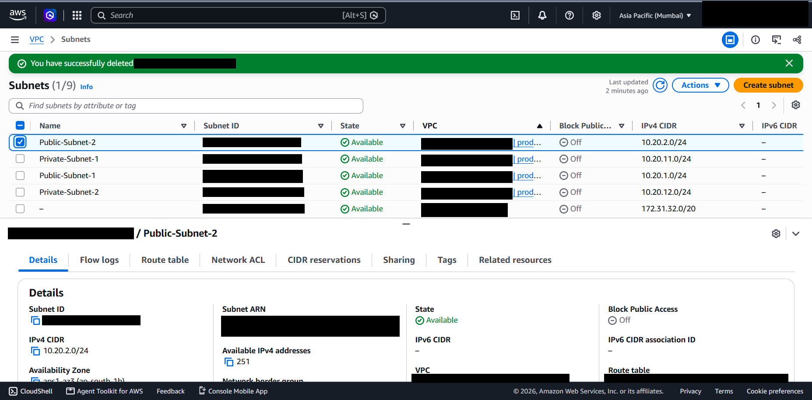

# 03 - Public and Private Subnets

## What it is

A subnet is a range of IP addresses inside a VPC, tied to one Availability Zone. This project defines two public and two private subnets, one of each per Availability Zone, to support a multi-AZ design.

## Why it is needed

Separating subnets by exposure lets internet-facing components (web servers, load balancers) sit apart from components that should never be reached directly (application servers, databases). Using two Availability Zones means a single zone failure does not remove an entire tier.

## How it works

- Public subnet: associated with a route table that has a `0.0.0.0/0` route to an Internet Gateway.
- Private subnet: associated with a route table that has no internet route. Outbound internet access, if needed, goes through a NAT gateway placed in a public subnet.
- AWS reserves five addresses in every subnet. A /24 therefore offers 251 usable addresses, which matches the screenshot below.

## Configuration in this project

*Figure 3.1 - Subnet list for `production-vpc`. `Public-Subnet-2` is selected: 10.20.2.0/24, 251 available IPv4 addresses, associated with `production-public-rt`, Availability Zone ap-south-1b.*

| Subnet | CIDR | Availability Zone | Tier | Route table | Status |
|---|---|---|---|---|---|
| Public-Subnet-1 | 10.20.1.0/24 | ap-south-1a | Public | `production-public-rt` | CIDR verified; AZ and association author-stated |
| Public-Subnet-2 | 10.20.2.0/24 | ap-south-1b | Public | `production-public-rt` | Verified |
| Private-Subnet-1 | 10.20.11.0/24 | ap-south-1a | Private | `production-private-rt` | CIDR verified; AZ and association author-stated |
| Private-Subnet-2 | 10.20.12.0/24 | ap-south-1b | Private | `production-private-rt` | CIDR verified; AZ and association author-stated |

All four subnets are in state Available with "Block Public Access" Off. The EC2 instance has private IP 10.20.1.254 and runs in ap-south-1a, which is consistent with Public-Subnet-1 (10.20.1.0/24).

### What is deployed in each subnet

Only Public-Subnet-1 contains a workload (the web server). The other three subnets are empty and exist as the foundation for the proposed design in [11](11-load-balancing-and-auto-scaling.md).

### Private subnet connectivity

No NAT gateway was observed or documented. Any instance placed in the private subnets today would have no outbound internet access (for example, no `apt` updates). This is a deliberate limitation of the current scope, not an oversight to hide.

## Security implications

- A public subnet is not secure by default; the security group is what restricts access.
- Auto-assign public IPv4 behaviour on the subnets was not captured. The instance did receive an auto-assigned address (see [04](04-ec2-and-nginx-deployment.md)).
- Keeping databases off public subnets is the single most important placement rule in the proposed design.

## Cost implications

Subnets are free. A NAT gateway, needed for private-subnet outbound access, is billed per hour and per GB processed, and is usually the largest networking cost in a small environment. One NAT gateway per AZ improves resilience but multiplies the hourly cost.

## Real-world use cases

Three-tier web applications, internal APIs, databases and caches in private tiers, and isolating management tooling.

## Implemented versus studied

Implemented: four subnets and two route tables; one instance in a public subnet. Studied only: NAT gateways, VPC endpoints, NACL rules per tier.
