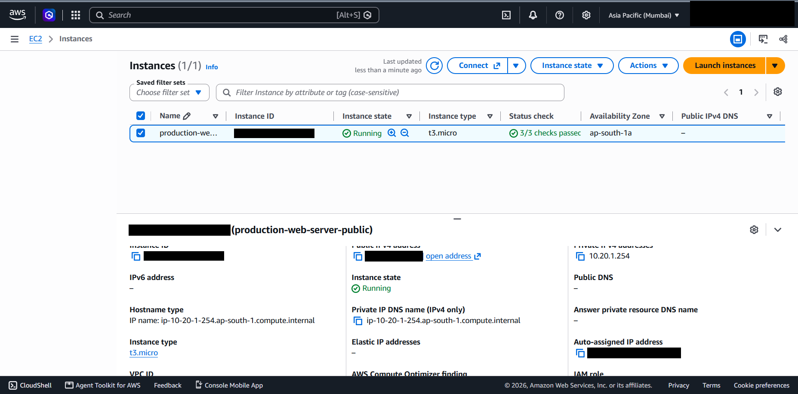
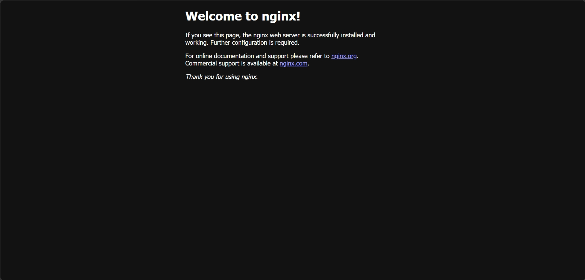

# 04 - EC2 and Nginx Deployment

## What it is

Amazon EC2 provides virtual servers. Nginx is a widely used open-source web server and reverse proxy. Together they form the simplest possible public web tier.

## Why it is needed

The project needed a real workload inside the VPC to exercise networking, security groups, storage and monitoring end to end, instead of describing them in the abstract.

## How it works

1. An instance is launched from an AMI into a subnet and receives a private IP from the subnet range.
2. If the subnet or launch settings assign a public IPv4 address, the Internet Gateway performs one-to-one NAT between the public and private address.
3. The security group decides which inbound packets reach the instance. Nginx then listens on port 80 (and 443 once TLS is configured).

## Configuration in this project



*Figure 4.1 - Instance `production-web-server-public`: running, `t3.micro`, ap-south-1a, 3/3 status checks passed, private IP 10.20.1.254, auto-assigned public IPv4 (blacked out), no Elastic IP, no public DNS name.*

| Property | Value | Status |
|---|---|---|
| Name | `production-web-server-public` | Verified |
| Instance type | `t3.micro` | Verified |
| Availability Zone | ap-south-1a | Verified |
| State / status checks | Running / 3 of 3 passed | Verified |
| Private IPv4 | 10.20.1.254 | Verified |
| Public IPv4 | Auto-assigned, not an Elastic IP | Verified |
| Operating system | Ubuntu Server 24.04 | Author-stated; consistent with the `noble-updates` repository in the apt output |
| Web server | Nginx | Verified by the default page |
| Instance IAM role | Not shown (field cut off) | Missing evidence |



*Figure 4.2 - The default "Welcome to nginx!" page. The screenshot has no address bar, so it does not on its own prove the page was served over the public IP. `systemctl status nginx` output was not captured.*

### Operations visible in the terminal evidence

The terminal screenshots (see [05](05-linux-administration.md)) show an interactive session on host `ip-10-20-1-254`, the login banner reporting 10 standard security updates pending, and a later `apt` run reporting 18 packages not upgraded. The session was opened from an address in the AWS range 13.233.177.0/29, which matches the SSH source rule in the security group. This is consistent with browser-based EC2 Instance Connect, but the connection method itself was not captured.

## Security implications

- The public IPv4 address is not an Elastic IP, so it changes whenever the instance is stopped and started. Do not publish it or hard-code it in DNS.
- Pending security updates should be applied (`apt upgrade`) and unattended security upgrades considered.
- The default Nginx page discloses the web server. For a real site, minimise version disclosure and add TLS.
- Whether IMDSv2 is required was not captured. The CloudWatch page lists a "Metadata no token" metric, which counts metadata requests made without a session token. Requiring IMDSv2 is the recommended setting.

## Cost implications

`t3.micro` is a burstable instance: it earns CPU credits at a baseline rate and spends them when busy (see credit metrics in [09](09-cloudwatch-monitoring.md)). Costs include instance hours, the EBS volume and the public IPv4 address. Free-tier eligibility depends on the account; verify current terms.

## Real-world use cases

Static sites, reverse proxies, small internal tools, bastion-style jump hosts, and the base image for an Auto Scaling group.

## Implemented versus studied

Implemented: one instance, Nginx default site. Studied only: TLS with certificates, custom Nginx server blocks, user data bootstrap, golden AMIs, SSM Session Manager.

## Illustrative commands (not captured in the evidence)

```bash
# Illustrative: check the service and test locally
sudo systemctl status nginx
curl -I http://localhost
sudo nginx -t
```
