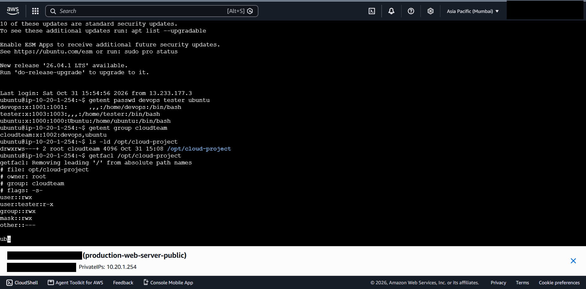
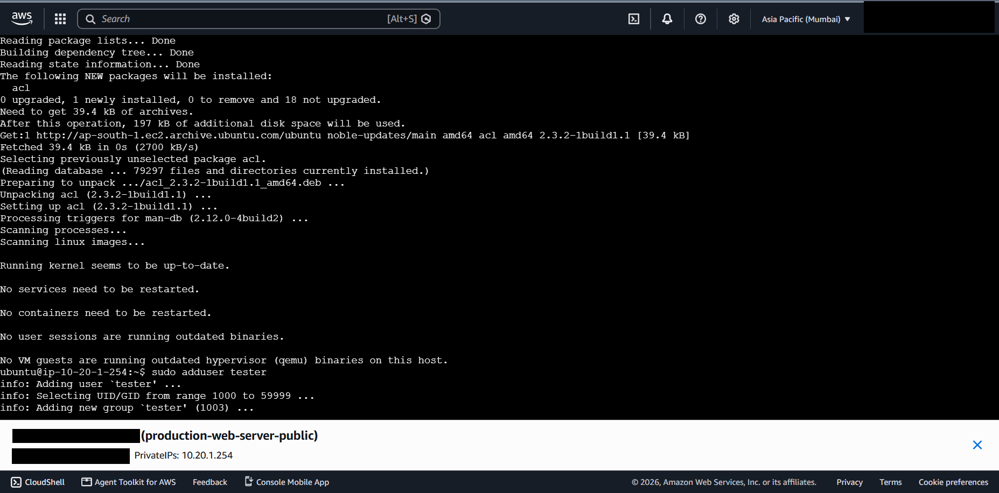

# 05 - Linux Administration

## What it is

Linux access control is built on users, groups, file mode bits and, optionally, POSIX ACLs. On a cloud server it is the layer that protects data once a request has passed the network controls.

## Why it is needed

AWS security groups say nothing about who can read a file on the instance. Separate administrative and test accounts, a shared group directory and an ACL for a restricted user demonstrate least privilege at the operating-system level.

## How it works

- A user has a UID and a primary group. Supplementary groups grant additional access.
- The setgid bit on a directory makes new files inherit the directory's group, which keeps shared directories consistent.
- POSIX ACLs add per-user or per-group entries beyond the single owner/group/other model. When ACL entries exist, the group field of `ls -l` displays the ACL **mask**, not only the owning group's permission.

## Configuration in this project

*Figure 5.1 - Users, group membership, directory mode and ACL for `/opt/cloud-project`. A personal name in the `devops` GECOS field was blacked out.*

| Item | Observed value | Status |
|---|---|---|
| Users | `ubuntu` (UID 1000), `devops` (UID 1001), `tester` (UID 1003) | Verified |
| Group | `cloudteam` (GID 1002), members `devops` and `ubuntu` | Verified |
| `tester` primary group | `tester` (GID 1003); not a member of `cloudteam` | Verified |
| Directory | `/opt/cloud-project`, owner `root`, group `cloudteam`, mode shown as `drwxrws---+` (setgid, `2770` plus ACL) | Verified |
| ACL | `user:tester:r-x`, `group::rwx`, `mask::rwx`, `other::---` | Verified |

*Figure 5.2 - The `acl` package installed via `apt` (it was not present beforehand) and `sudo adduser tester` starting.*

### Interpretation

- Members of `cloudteam` have full access; files they create inherit group `cloudteam` because of setgid.
- `tester` is not in the group and is granted read and traverse only (`r-x`) by the ACL. Write access is not granted.
- Everyone else has no access (`other::---`).
- The commands that created the group, directory, mode and ACL entry were not captured, only the resulting state. Reconstructed equivalents are in [linux/permissions-and-acls.md](../linux/permissions-and-acls.md).
- No test showing `tester` succeeding at reading and failing at writing was captured. See the [checklist](missing-evidence-checklist.md).

## Security implications

- Individual named accounts support auditing; sharing the default `ubuntu` account does not.
- Real names in account metadata leak personal information when screenshots are published.
- ACLs are powerful but easy to forget. Document them and review with `getfacl`.
- Password policy, SSH key management and `sudo` scope for `devops` were not captured.

## Cost implications

None directly. Poor access control raises indirect cost through incident response and data exposure.

## Real-world use cases

Shared project directories for teams, read-only access for auditors or contractors, and service accounts that own application data.

## Implemented versus studied

Implemented and verified: the three users, the group, the setgid directory and the ACL. Studied only: `sudoers` design, PAM policy, SSH hardening, centralised identity.

Further detail: [users and groups](../linux/users-and-groups.md), [permissions and ACLs](../linux/permissions-and-acls.md), [service management](../linux/service-management.md).
