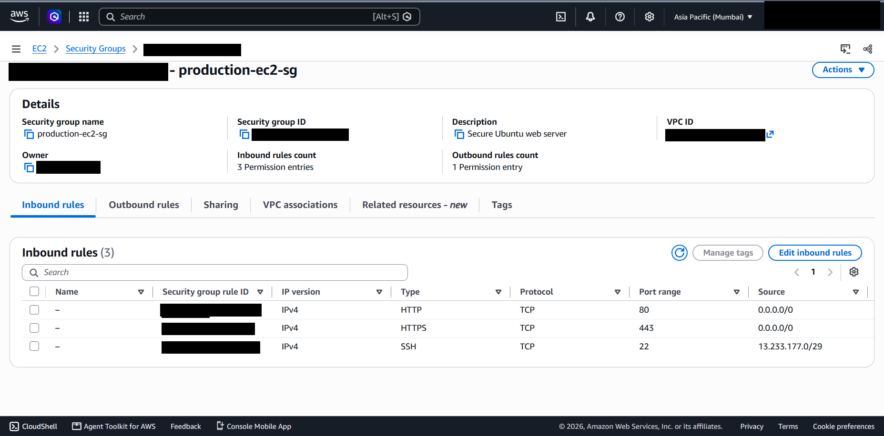

# 07 - Security Architecture

## What it is

The set of controls that protect the environment at each layer: network, instance, data and visibility.

## Why it is needed

No single control is sufficient. Defence in depth means a failure in one layer (a permissive rule, an unpatched package) is contained by the others.

## How it works in AWS

- **Security groups** are stateful, instance-level allow lists. They have no deny rules. Return traffic for an allowed request is automatically permitted.
- **Network ACLs** are stateless, subnet-level rules with allow and deny. The default NACL allows all traffic.
- **Route tables** decide what is reachable at all.

## Layers in this project

| Layer | Control | Status |
|---|---|---|
| Network topology | Custom VPC, public/private subnet split | Verified |
| Instance firewall | Security group `production-ec2-sg` | Verified |
| Access to the host | SSH restricted to a /29 range | Verified |
| Operating system | Users, group, setgid directory, ACL | Verified |
| Data at rest | Account-level EBS default encryption enabled | Verified (applies to new volumes only) |
| AMI exposure | Block public access for AMIs: new public sharing blocked | Verified |
| Visibility | CloudWatch basic metrics | Verified; no alarms, no Flow Logs, no CloudTrail evidence |

## Security group evidence

*Figure 7.1 - `production-ec2-sg` ("Secure Ubuntu web server"): 3 inbound rules and 1 outbound rule. The account ID and all resource and rule identifiers are blacked out.*

| Direction | Protocol / port | Source | Purpose |
|---|---|---|---|
| Inbound | TCP 80 (HTTP) | 0.0.0.0/0 | Public website |
| Inbound | TCP 443 (HTTPS) | 0.0.0.0/0 | Public website over TLS |
| Inbound | TCP 22 (SSH) | 13.233.177.0/29 | Administration from a narrow range |
| Outbound | 1 rule | Not captured | Presumably the default allow-all; verify |

SSH is **not** open to `0.0.0.0/0`. This repository never recommends doing so. The /29 source appears to be the AWS EC2 Instance Connect range for `ap-south-1`; confirm against the current published AWS IP ranges, because those ranges can change. A stronger alternative is SSM Session Manager with no inbound SSH rule at all.

## Findings and recommendations

| # | Finding | Severity | Recommendation |
|---|---|---|---|
| 1 | Port 443 is open but no TLS configuration was evidenced; only the default HTTP page was shown | Medium | Install a certificate (for example via an ALB with ACM, or Let's Encrypt) or close 443 until TLS exists |
| 2 | Public IPv4 is not an Elastic IP and changes on stop/start | Low | Use a load balancer or an Elastic IP if a stable address is needed |
| 3 | Pending OS updates (10 security updates in the login banner) | Medium | Apply updates; enable unattended security upgrades |
| 4 | Root volume reported unencrypted (author-stated) | Medium | Migrate to an encrypted volume; see [08](08-ebs-and-storage.md) |
| 5 | No CloudWatch alarms, VPC Flow Logs or CloudTrail evidence | Medium | Add alarms and logging; see [09](09-cloudwatch-monitoring.md) |
| 6 | Outbound rule and NACL not inspected | Low | Review and restrict egress if appropriate |
| 7 | Instance IAM role and IMDSv2 enforcement not evidenced | Low | Verify and enforce IMDSv2 |
| 8 | Real name present in a Linux account field and account IDs present in raw screenshots | Informational | Already redacted in the published copies; keep originals private |

## Cost implications

Security groups, NACLs and IAM are free. Logging (CloudTrail data events, Flow Logs, CloudWatch Logs), WAF, GuardDuty and Config have per-use costs; enable them proportionately to risk.

## Real-world use cases

Meeting baseline benchmarks such as the CIS AWS Foundations Benchmark, limiting the blast radius of a compromised web server, and passing customer security reviews.

## Implemented versus studied

Implemented and verified: the security group, SSH restriction, Linux controls, account-level encryption default. Studied only: NACL tuning, WAF, GuardDuty, Security Hub, Config rules.
