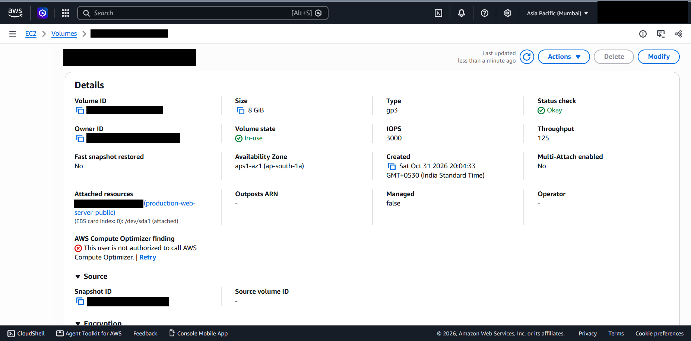
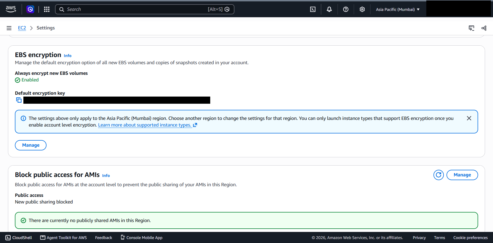

# 08 - EBS and Storage

## What it is

Amazon Elastic Block Store (EBS) provides network-attached block volumes for EC2. The instance's root disk is an EBS volume created from the AMI's snapshot.

## Why it is needed

It persists data independently of the instance's lifecycle, supports snapshots for backup, and can be encrypted transparently using AWS KMS.

## How it works

- gp3 volumes provide a baseline of 3,000 IOPS and 125 MiB/s regardless of size, with IOPS and throughput adjustable independently of capacity.
- A volume lives in one Availability Zone and can only attach to instances in that zone.
- Encryption uses AWS KMS keys. When enabled, data at rest, snapshots and data moving between the volume and the instance are encrypted, with negligible performance impact.
- "Always encrypt new EBS volumes" is a per-Region account setting. It affects **newly created** volumes and snapshot copies only. It does not change existing volumes.

## Configuration in this project

*Figure 8.1 - Root volume details (volume, owner, snapshot and instance identifiers blacked out). The page is cut off just above the Encryption section, so the encryption state is not visible in this screenshot.*

| Property | Value | Status |
|---|---|---|
| Size / type | 8 GiB / gp3 | Verified |
| IOPS / throughput | 3000 / 125 (MiB/s) | Verified |
| State / status check | In-use / Okay | Verified |
| Availability Zone | ap-south-1a | Verified |
| Attachment | Root device `/dev/sda1` of `production-web-server-public` | Verified |
| Created | Sat Oct 31 2026, 20:04:33 IST | Verified |
| Source | Created from an AMI snapshot | Verified |
| Multi-Attach / fast snapshot restore | No / No | Verified |
| Encrypted | **No** | Author-stated; not visible in the screenshot |

*Figure 8.2 - EC2 Settings: "Always encrypt new EBS volumes" is Enabled in the Mumbai Region, with a default KMS key configured (the key ARN is blacked out, so key type and ID are not shown). "Block public access for AMIs" blocks new public sharing, and no public AMIs exist in the Region.*

### Why the root volume can be unencrypted while the default is on

If the volume is unencrypted, as reported, the most likely explanation is that it was created from an unencrypted AMI snapshot, or before the default was enabled; the default applies only to volumes and copies created afterwards. The order of events was not captured. The screenshot does not show whether the default key is the AWS-managed key (`aws/ebs`) or a customer-managed key.

### Illustrative migration to an encrypted root volume (not performed)

1. Stop the instance and create a snapshot of the root volume.
2. Copy the snapshot with encryption enabled (the default key applies if none is chosen).
3. Create a new gp3 volume from the encrypted copy in the same AZ.
4. Detach the old root volume and attach the new one as `/dev/sda1`, then start the instance.
5. Verify boot, services and `Encrypted: Yes`, then delete the old volume once recovery is no longer needed.

A cleaner production approach is to bake an encrypted AMI and launch replacement instances from it.

## Security implications

- Unencrypted snapshots can be shared or copied more easily than encrypted ones; encryption plus key policies adds a second control.
- A customer-managed KMS key adds auditable key usage and revocation, at extra cost and operational responsibility.
- Whether "delete on termination" is set was not captured.

## Cost implications

EBS is billed per GB-month of provisioned storage, plus extra for IOPS or throughput above gp3 baseline, and for snapshots. AWS-managed keys have no key fee; customer-managed keys have a monthly fee plus request charges. Detached volumes continue to cost money.

## Real-world use cases

Boot volumes, database volumes (io2 or gp3), encrypted storage for regulated workloads, and snapshot-based backup and cloning.

## Implemented versus studied

Implemented: one gp3 root volume. Inspected: account default encryption. Studied only: volume migration, customer-managed keys, additional data volumes, snapshot lifecycle policies.
