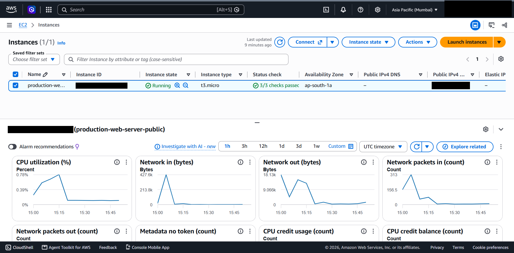

# 09 - CloudWatch Monitoring

## What it is

Amazon CloudWatch collects metrics, logs and events from AWS resources and supports dashboards and alarms. For EC2, the hypervisor-level metrics (CPU, network, disk I/O for instance store, status checks) are published automatically.

## Why it is needed

You cannot operate or right-size what you cannot see. Metrics show whether the server is healthy and whether a burstable instance is running out of CPU credits; alarms turn that data into action.

## How it works

- Basic monitoring publishes EC2 metrics at 5-minute intervals at no charge. Detailed monitoring publishes at 1-minute intervals for an extra fee.
- Memory and disk-usage metrics are **not** collected by default; they require the CloudWatch agent and an instance role with permission to publish them.
- Status checks report system-level (AWS hardware) and instance-level (OS) problems. "3/3 checks passed" in the console corresponds to the system, instance and attached-EBS checks.
- Alarms evaluate a metric against a threshold and can notify via SNS or trigger an action such as instance recovery.

## Configuration in this project

*Figure 9.1 - EC2 Monitoring tab, 1-hour view, UTC timezone. Instance ID and public IP blacked out.*

| Observation | Value from the screenshot | Status |
|---|---|---|
| Instance state / status checks | Running / 3 of 3 passed | Verified |
| CPU utilisation, 1 h window | Axis maximum 0.78%; peak near the start of the window (about 15:10 UTC), then about 0.1% | Verified |
| Network in | Peak about 427.6 k bytes, then near zero | Verified |
| Network out | Peak about 18.13 k bytes | Verified |
| Network packets in | Peak 313 | Verified |
| Additional charts present | Network packets out, Metadata no token, CPU credit usage, CPU credit balance | Verified (values not visible) |
| Alarm recommendations toggle | Off; no alarms shown | Verified |
| CPU 3.62% reading | Reported by the author for a different inspection | **Not visible in any screenshot; not reproduced here** |

### Interpretation

- Activity is concentrated early in the window and then drops to idle, which is consistent with setup work such as package installation followed by an idle web server. This is an inference; the cause was not recorded.
- The author-stated 3.62% CPU figure does not conflict with the 0.78% maximum shown, because it comes from a different time window, but it cannot be verified from the screenshots and is therefore listed in the missing-evidence checklist.
- CPU credit balance is the metric to watch on `t3.micro`. Sustained load drains it and throttles CPU to the baseline.

## Recommended next steps (not implemented)

Illustrative alarm definitions:

| Alarm | Condition | Reason |
|---|---|---|
| High CPU | `CPUUtilization` above 80% for 2 of 3 periods | Early warning of saturation |
| Status check failed | `StatusCheckFailed` at or above 1 for 2 periods | Hardware or OS failure |
| Low CPU credits | `CPUCreditBalance` below a chosen floor | Imminent throttling on burstable instances |

Also consider the CloudWatch agent for memory, disk and Nginx logs, and a CloudWatch Logs group for centralised logging.

## Security implications

Metrics and logs are an audit and detection source. Restrict who can read or delete log groups, and avoid logging secrets.

## Cost implications

Basic EC2 metrics and the first alarms and dashboards within the free allowance cost nothing; detailed monitoring, custom metrics, log ingestion, log retention and additional alarms are billed. Set log retention periods explicitly.

## Real-world use cases

Capacity planning, Auto Scaling policies driven by CPU or request metrics, incident detection, and post-incident review.

## Implemented versus studied

Inspected: basic monitoring. Studied only: alarms, SNS notifications, the CloudWatch agent, logs, dashboards.
